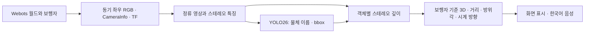
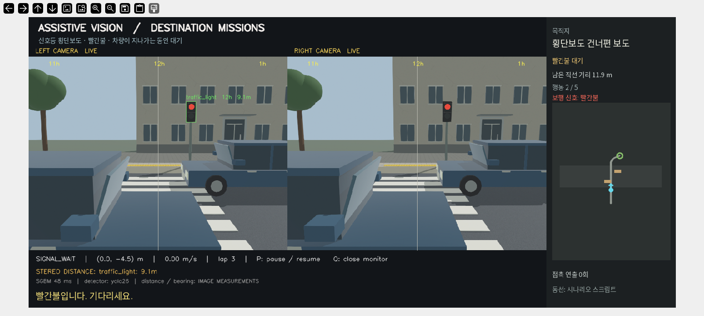

# CV PROJECT

시각장애인 보행 보조를 위한 **Webots 시나리오 → YOLO26 객체 탐지 → 객체별 스테레오 거리·방향 추정 → 한국어 안내** 파이프라인입니다.

기준 거리 월드 외에 주거 골목·중정·역 앞 광장·신호등 횡단보도 월드를 추가했습니다. 목적지까지 이동하며 장애물을 우회하고, 신호에 따라 대기하는 상황을 재생합니다. 각 모듈과 시나리오는 독립적으로 업그레이드할 수 있습니다. 보행 경로는 시연용으로 미리 정해져 있으며, 인식 결과로 자율 회피하는 시스템은 아닙니다.



**거리 알고리즘에 시뮬레이터의 물체 좌표를 넘기지 않습니다.** 탐지 모듈과 깊이 모듈 사이에는 촬영 시각, 물체 이름, bbox, confidence, 선택적 추적 ID만 전달합니다.

## 설치와 실행

아래 명령은 **Ubuntu 데스크톱의 Bash 터미널**에서 실행합니다. 프로젝트 설치 후에는 저장소 루트, 즉 `scripts/`와 `README.md`가 있는 폴더에서 명령을 실행하세요.

### 1. 처음 사용하는 PC: 시스템 준비

| 항목 | 실행 기준 |
| --- | --- |
| OS / Python | Ubuntu 22.04 / 시스템 Python 3.10 |
| ROS | ROS 2 Humble; Desktop 설치 기준 |
| 시뮬레이터 | Webots R2025a |
| 화면·음성 | GUI가 열리는 데스크톱 세션, 음성 시연용 오디오 출력 |
| GPU | 필수 아님; CPU에서도 실행 가능하며 처리 속도는 PC에 따라 달라짐 |

먼저 [ROS 2 Humble 공식 설치 안내](https://docs.ros.org/en/humble/Installation/Ubuntu-Install-Debs.html)에 따라 ROS를 설치하고, [Webots R2025a 릴리스](https://github.com/cyberbotics/webots/releases/tag/R2025a)의 Ubuntu용 패키지를 설치합니다. 프로젝트의 `setup.sh`는 ROS와 Webots를 설치하지 않습니다.

이후 필요한 시스템 패키지를 설치합니다. `ros-humble-tf2-ros`는 ROS 저장소 설정을 마친 뒤 설치할 수 있습니다.

```bash
sudo apt update
sudo apt install git python3-venv libgl1 fonts-noto-cjk espeak-ng pulseaudio-utils ros-humble-tf2-ros
```

Webots 실행 파일을 자동으로 찾지 못하면 실제 설치 경로를 지정합니다. 아래는 기본 `.deb` 설치 경로의 예시이며 다른 위치에 설치했다면 바꾸세요.

```bash
export WEBOTS_BIN=/usr/local/webots/webots
```

이 설정은 현재 터미널에 적용됩니다. 다른 터미널에서 실행할 때도 필요하면 다시 지정합니다. 다른 설치 경로와 Python 환경 설정은 [SETUP](docs/SETUP.md)을 참고하세요.

### 2. 최초 1회: 프로젝트와 모델 설치

```bash
git clone https://github.com/boss123516/CV-project.git
cd CV-project

# 시스템 ROS Python 패키지를 함께 사용하는 .venv 생성 및 프로젝트 설치
./scripts/setup.sh --yolo

# 기본 YOLO26n 가중치 다운로드; 학습을 시작하는 명령이 아님
.venv/bin/python scripts/download_models.py

# 실행에 필요한 Python 패키지·Webots 경로·가중치 확인
./scripts/doctor.sh --pipeline yolo26
```

설치와 모델 다운로드에는 인터넷 연결이 필요합니다. 가중치는 Git에 포함되지 않으며 다운로드 후 `models/yolo26n.pt`에 저장됩니다. `doctor` 결과가 모두 `true`이면 실행 단계로 넘어갑니다. `doctor`는 의존성 사전 검사이며 GUI·음성·시나리오 동작은 실제 실행으로 확인합니다.

### 3. 실행: 신호등 횡단보도부터 확인

설치를 마쳤다면 이후에는 저장소 루트에서 아래 명령으로 실행합니다.

```bash
./scripts/run.sh --pipeline yolo26 --scenario signalized_crossing
```

이 명령은 Webots, YOLO26 탐지, 스테레오 거리 계산, 카메라 모니터, 한국어 음성 안내를 함께 시작합니다. 실행 스크립트가 ROS 환경과 프로젝트 Python을 설정하므로 가상환경을 수동으로 activate할 필요는 없습니다.

정상 실행 시 잠시 뒤 다음을 확인할 수 있습니다.

- **Webots 창:** 보행자가 횡단보도로 접근하고, 차량이 지나가며 빨간불에 대기합니다. 초록불과 차량 정지 조건이 충족되면 건너가 목적지에 도착하고 시나리오를 반복합니다.
- **Stereo ROS Monitor 창:** 좌우 카메라의 `LIVE` 영상, 탐지된 객체의 bbox·거리·시계 방향, 목적지·현재 행동·동선 지도가 표시됩니다.
- **음성:** “빨간불입니다. 기다리세요.”, “초록불로 바뀌었습니다. 차량이 멈춘 것을 확인하고 건너세요.”를 들을 수 있습니다. 객체 안내는 탐지와 유효 거리 계산이 성공할 때 나옵니다.

현재 신호와 보행 동작은 시나리오 제어이며, 신호 색상을 영상으로 판정한 결과가 아닙니다. 기본 YOLO26n은 프로젝트 전용 장애물을 모두 학습하지 않았으므로 화면에 보이는 모든 물체에 bbox가 뜨는 것은 아닙니다.

실행 명령은 프로그램을 **백그라운드에서 시작한 뒤 터미널로 돌아옵니다.** 같은 터미널에서 상태를 확인할 수 있습니다.

```bash
source scripts/env.sh
"$CV_PYTHON" -m cv_project status
```

기본 실행에서는 `sim`, `detector`, `perception`, `viewer`, `voice`의 `running`이 모두 `true`인지 확인합니다. `--no-viewer`나 `--no-voice`를 사용했다면 해당 구성 요소는 목록에서 제외됩니다.

### 4. 다른 시나리오로 전환 / 종료

다른 시나리오나 파이프라인으로 바꿀 때는 **기존 실행을 먼저 종료**합니다.

```bash
# 신호등 시나리오 종료 후 주거 골목의 접촉·후진·우회 시나리오 실행
./scripts/stop.sh
./scripts/run.sh --pipeline yolo26 --scenario residential_detour

# 시연을 마치면 전체 구성 요소 종료
./scripts/stop.sh
```

실행 가능한 전체 10개 ID는 아래 명령 또는 [목적지 시나리오](#목적지우회교통-시나리오)·[기존 구간 시나리오](#기존-기준-거리의-구간-시나리오)에서 확인합니다. `--scenario` 뒤의 ID만 바꾸면 됩니다.

```bash
source scripts/env.sh
"$CV_PYTHON" -m cv_project list-scenarios
```

| 키 / 명령 | 동작 |
| --- | --- |
| `P` | Webots 또는 모니터에 포커스를 둔 상태에서 보행 정지·재개 |
| `R` | Webots에 포커스를 둔 상태에서 보행 경로 재시작 |
| `V` | Webots에 포커스를 둔 상태에서 외부 관찰 시점 추적 전환 |
| `Q` | 모니터 창만 종료 |
| `./scripts/stop.sh` | Webots·탐지·거리 계산·모니터·음성을 모두 종료 |

`Q`로 모니터를 닫거나 실행 터미널에서 `Ctrl+C`를 누르는 것만으로는 전체 프로세스가 종료되지 않습니다. 전체 종료에는 `stop.sh`를 사용하세요.

## 두 가지 실행 모드

| 설정 | 객체 탐지 입력 | 거리·각도 | 목적 |
| --- | --- | --- | --- |
| `yolo26` | 정류된 좌측 영상에 YOLO26 추론 | 좌우 영상으로 계산 | 실제 탐지 모듈 통합 |
| `baseline` | Webots에서 가져온 임시 이름·bbox | 좌우 영상으로 계산 | 커스텀 학습 전 전체 흐름을 재현·검증 |

```bash
# 먼저 실행 중인 시나리오 종료
./scripts/stop.sh

# 학습 전 프로젝트 장애물 bbox를 사용해 거리 계산 흐름 재현
./scripts/run.sh --pipeline baseline --scenario urban_baseline

# 실제 YOLO26으로 횡단 보행자 구간 실행
./scripts/stop.sh
./scripts/run.sh --pipeline yolo26 --scenario crossing_pedestrian

# 카메라 모니터·음성 없이 실행; Webots GUI는 계속 열림
./scripts/stop.sh
./scripts/run.sh --pipeline baseline --scenario occluded_sign --no-viewer --no-voice
```

`baseline`은 시뮬레이터의 이름·bbox를 쓰는 재현용 모드이므로 YOLO 학습 성능을 보여주는 모드와 구분합니다. 두 모드 모두 거리는 좌우 영상에서 계산합니다. 기본 `ROS_DOMAIN_ID`는 71이며, 상태 확인용 터미널에서도 `scripts/env.sh`를 source하면 같은 설정을 사용합니다.

기본 YOLO26n 체크포인트는 COCO 사전학습 모델입니다. 사람·차·벤치 등의 시작점으로 사용할 수 있지만, 현재 월드의 입간판·낮은 말뚝·기둥·콘 등 프로젝트 클래스 전체가 학습되어 있는 것은 아닙니다. **프로젝트 클래스 학습과 실제 환경 정확도 평가는 앞으로 진행할 작업입니다.** 탐지가 없거나 깊이 측정에 실패하면 정답값으로 대체하지 않습니다.

## 실행이 안 될 때

| 증상 | 확인·조치 |
| --- | --- |
| `webots: false` 또는 Webots 경로 오류 | `WEBOTS_BIN`을 실제 실행 파일로 지정하고 `doctor` 재실행 |
| `rclpy: false` 또는 ROS 모듈 import 오류 | ROS 2 Humble 설치와 `/opt/ros/humble/setup.bash` 확인; 다른 설치 위치는 `ROS_SETUP`으로 지정. 별도 Python을 쓰면 시스템 ROS 바인딩 접근 여부 확인 |
| `model_weights: false` | `.venv/bin/python scripts/download_models.py`로 가중치 다운로드 |
| `ultralytics: false` | `./scripts/setup.sh --yolo`로 YOLO 의존성 설치 |
| `A different pipeline/scenario is running` | `./scripts/stop.sh`로 종료한 뒤 원하는 설정으로 다시 실행 |
| 창이 열리지 않거나 Qt/display 오류 | GUI가 열리는 데스크톱 세션에서 실행. `--no-viewer`만으로 Webots가 headless 실행되는 것은 아님 |
| 음성이 들리지 않음 | 시스템 오디오 출력·음소거 상태와 `espeak-ng`, `paplay` 설치 확인; 음성이 필요 없으면 종료 후 `--no-voice`를 붙여 재실행 |
| 모니터가 계속 `WAITING FOR TOPIC`이거나 구성 요소가 종료됨 | `status`와 아래 로그에서 simulator/controller·탐지·거리 노드 오류 확인 |

```bash
./scripts/doctor.sh --pipeline yolo26
tail -n 40 webots/logs/sim.log webots/logs/detector.log webots/logs/perception.log webots/logs/viewer.log webots/logs/voice.log
```

로그와 PID는 기본적으로 `webots/logs/`에 저장합니다. `CV_RUN_DIR`을 지정했다면 해당 디렉터리를 확인하세요. 자세한 설치 경로 설정은 [SETUP](docs/SETUP.md)에 있습니다.

## 학습할 객체

최종 탐지 모델은 기존 클래스 ID를 유지한 **10종**으로 준비합니다.

| 구분 | 클래스 | 작업 |
| --- | --- | --- |
| 신규 클래스 6종 | `traffic_cone`, `signboard`, `bollard`, `pole`, `barrier`, `planter` | 프로젝트 장애물 데이터 수집·라벨링·학습 |
| 기존 클래스 보강 4종 | `bench`, `pedestrian`, `car`, `traffic_light` | 현재 월드 외형·가림·거리 조건에 맞춰 fine-tuning |
| 별도 신호 상태 판정 | `red`, `green`, `unknown` | 신호등 ROI의 상태 판정 모듈과 평가 데이터 준비; 현재 미구현 |

[학습 대상·우선순위·시나리오·라벨링 기준](docs/TRAINING_OBJECTS.md)에 클래스별 bbox 범위와 데이터 분리 방법을 정리했습니다. 현재 자동 수집에서는 신호등과 일부 배경 화단 라벨이 빠지므로 검수·보완이 필요합니다. 신호 색 상태는 위 10종 객체 클래스에 포함된 출력이 아닙니다.

## 모듈 구조

```text
CV-PROJECT/
├── cv_project/
│   ├── contracts.py          # 탐지 → 깊이 추정 공통 데이터 형식
│   ├── config.py             # 경로·파이프라인·시나리오 로더
│   ├── detection/            # Detector 인터페이스, YOLO26, 임시 어댑터
│   ├── depth/                # 깊이 인터페이스, SGBM 기준 구현, backend 등록
│   ├── guidance/             # 거리·시계 방향 문장, 음성 안내
│   └── pipeline/             # ROS 영상·보정·TF·탐지 결과 연결
├── config/
│   ├── pipelines/            # baseline.json / yolo26.json
│   ├── stereo_rig.json       # 카메라 설치 보정·스테레오 파라미터
│   └── object_classes.json   # 클래스 ID·한국어 이름
├── scenarios/                # 실행 가능한 시나리오 manifest·공통 동선
├── webots/
│   ├── worlds/               # 기준 상가 거리 월드
│   ├── protos/               # 보행자 모델과 원본 라이선스 고지
│   ├── controllers/          # 보행·지팡이·좌우 카메라 ROS 브리지
│   ├── textures/             # 로컬 텍스처·상가 간판
│   └── scripts/              # 월드 생성, 영상 모니터, 데이터 수집
├── models/                   # 체크포인트 위치 안내; 가중치는 Git 제외
├── scripts/                  # 설치·실행·종료·환경 점검
├── tests/                    # 알고리즘·데이터 계약·시나리오 검사
└── docs/                     # 설치, 인터페이스, 알고리즘, 확장 가이드
```

기존 `perception.*` import와 일부 Webots 스크립트는 호환용 진입점으로 남겼습니다. 새 기능은 `cv_project/`에 추가합니다.

## 목적지·우회·교통 시나리오

새 환경은 각각 별도의 Webots 월드입니다. 가게 이름·메뉴 문구를 제거했고, 곡선 동선을 걸으며 접촉 연출·후진·우회·도착과 신호 대기를 보여 줍니다.

| ID | 상황 |
| --- | --- |
| `residential_detour` | 펜스를 만나 뒤로 물러난 후 옆 골목으로 우회해 주거동 출입구 도착 |
| `courtyard_detour` | 중정 화단을 돌아 공동현관으로 이동 |
| `station_access_detour` | 보행자를 기다린 뒤 막힌 진입로 대신 옆 접근로 이용 |
| `signalized_crossing` | 빨간불에 정지·음성 안내, 차량 통행 후 초록불 횡단 |

**동선·접촉·신호 전환은 시나리오 제어입니다.** 실제 영상 기반 자율 회피나 신호 색상 인식으로 표시하지 않습니다. 탐지·스테레오 계산은 그 장면의 실제 영상에서 별도로 실행합니다. [상세 시나리오와 검증](docs/DESTINATION_MISSIONS.md)

## 기존 기준 거리의 구간 시나리오

| ID | 실행 구간 | 검증할 어려움 |
| --- | --- | --- |
| `urban_baseline` | 0–39.5m | 상가 거리 전체 동선 |
| `occluded_sign` | 7–14m | 입간판 뒤에 일부 가려진 낮은 말뚝 |
| `slender_pole` | 14–21m | 가느다란 기둥, 배경 대비와 그림자 |
| `construction_passage` | 21–28m | 콘·공사 펜스로 좁아진 통로 |
| `crossing_pedestrian` | 28–35m | 주차 차량 근처에서 가로지르는 사람 |
| `driveway_transition` | 35–39.5m | 포장 질감·점자블록·경계석 변화 |

이들은 **하나의 기준 월드를 공유하면서 실제 보행 시작·종료·속도를 바꾸는 실행 시나리오**입니다. 서로 다른 거리 월드 여섯 개를 복제한 것은 아닙니다. 다음 환경은 manifest의 `world`와 `scene`을 추가해 확장할 수 있습니다. [시나리오 추가 가이드](docs/EXTENDING.md)



## 객체별 깊이와 안내

640×480 좌우 카메라를 12cm 간격으로 장착합니다. 정류·시차 계산·좌우 일치 검사 후 물체 영역의 유효한 표면 군집을 찾아 3D로 복원합니다. 카메라에서 보행자로의 설치 변환을 적용해 수평 거리와 각도를 구합니다.

```text
시차 → 깊이:       Z = fx × baseline / corrected_disparity
보행자 기준 거리:  hypot(x_forward, y_left)
시계방향 방위각:   atan2(-y_left, x_forward)
안내 예:           “11시 방향, 3미터 앞에 입간판이 있습니다.”
```

출력은 대표적인 가시 표면까지의 거리이며, 물체 전체의 가장 가까운 면까지의 여유 거리는 아닙니다. 무늬 부족·가림·불일치·큰 불확실성에서는 `valid=false`와 사유를 내보냅니다. [알고리즘과 한계](docs/STEREO_ALGORITHM.md)

## 개발·검증

```bash
python3 -m unittest discover -s tests -v
python3 -m cv_project start --pipeline yolo26 --scenario occluded_sign --dry-run
```

ROS/Webots 없이 실행하는 핵심 테스트와 GitHub Actions를 포함했습니다. 실제 연결은 `webots/scripts/check_streams.py`, `validate_runtime.py`로 점검할 수 있습니다. [인터페이스](docs/INTERFACES.md), [확장 방법](docs/EXTENDING.md), [검증 기록](docs/VALIDATION.md)

앞으로의 작업은 커스텀 YOLO26 학습, 객체별 깊이 추정 알고리즘 개선, 다양한 조명·외형·가림 조건의 시나리오 추가, 거리·각도 오차 및 미검출률 평가입니다.

원본과 자산별 라이선스는 [THIRD_PARTY.md](THIRD_PARTY.md)에 기록했습니다. 가중치·데이터셋·실행 로그는 Git에 포함하지 않습니다.
