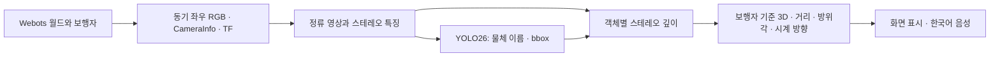

# CV PROJECT

시각장애인 보행 보조를 위한 **Webots 시나리오 → YOLO26 객체 탐지 → 객체별 스테레오 거리·방향 추정 → 한국어 안내** 파이프라인입니다.

현재의 상가 거리 월드를 기준 환경으로 보존하고, 각 모듈과 시나리오를 독립적으로 업그레이드할 수 있도록 구성했습니다. 보행 경로는 시연용으로 미리 정해져 있으며, 인식 결과로 자율 회피하는 시스템은 아닙니다.



**거리 알고리즘에 시뮬레이터의 물체 좌표를 넘기지 않습니다.** 탐지 모듈과 깊이 모듈 사이에는 촬영 시각, 물체 이름, bbox, confidence, 선택적 추적 ID만 전달합니다.

## 빠른 시작

환경: Ubuntu 22.04, Python 3.10, ROS 2 Humble, Webots R2025a. 설치와 다른 PC 설정은 [SETUP](docs/SETUP.md)을 참고하세요.

```bash
git clone git@github.com:boss123516/CV-project.git
cd CV-project
./scripts/setup.sh --yolo
.venv/bin/python scripts/download_models.py

# 실제 YOLO26 탐지 + 스테레오 깊이 + 전체 거리
./scripts/run.sh --pipeline yolo26 --scenario urban_baseline

# 종료
./scripts/stop.sh
```

첫 실행 전 `./scripts/doctor.sh --pipeline yolo26`로 의존성과 체크포인트를 확인할 수 있습니다. `WEBOTS_BIN`, `ROS_SETUP`, `CV_PYTHON`으로 설치 위치를 지정할 수 있고, 기본 ROS_DOMAIN_ID는 71입니다.

## 두 가지 실행 모드

| 설정 | 객체 탐지 입력 | 거리·각도 | 목적 |
| --- | --- | --- | --- |
| `yolo26` | 정류된 좌측 영상에 YOLO26 추론 | 좌우 영상으로 계산 | 실제 탐지 모듈 통합 |
| `baseline` | Webots에서 가져온 임시 이름·bbox | 좌우 영상으로 계산 | 커스텀 학습 전 전체 흐름을 재현·검증 |

```bash
# 임시 bbox를 쓰는 재현용 모드임을 명시적으로 선택
./scripts/run.sh --pipeline baseline --scenario urban_baseline

# 원하는 구간만 반복
./scripts/run.sh --pipeline yolo26 --scenario crossing_pedestrian

# 외부 창과 음성 없이 실행
./scripts/run.sh --pipeline baseline --scenario occluded_sign --no-viewer --no-voice

# 현재 실행 상태 / 시나리오 목록
source scripts/env.sh
python3 -m cv_project status
python3 -m cv_project list-scenarios
```

파이프라인·시나리오를 전환할 때는 기존 실행을 먼저 종료합니다. `P`는 보행 정지/재개, Webots의 `R`은 경로 재시작, `V`는 외부 관찰 시점 추적 전환, 모니터의 `Q`는 모니터만 종료합니다.

기본 YOLO26n 체크포인트는 COCO 사전학습 모델입니다. 사람·차·벤치 등의 시작점으로 사용할 수 있지만, 현재 월드의 입간판·낮은 말뚝·기둥·콘 등 프로젝트 클래스 전체가 학습되어 있는 것은 아닙니다. **프로젝트 클래스 학습과 실제 환경 정확도 평가는 앞으로 진행할 작업입니다.** 탐지가 없거나 깊이 측정에 실패하면 정답값으로 대체하지 않습니다.

## 모듈 구조

```text
CV-PROJECT/
├── cv_project/
│   ├── contracts.py          # 탐지 → 깊이 추정 공통 데이터 형식
│   ├── config.py             # 경로·파이프라인·시나리오 로더
│   ├── detection/            # Detector 인터페이스, YOLO26, 임시 어댑터
│   ├── depth/                # 깊이 인터페이스, SGBM 기준 구현, backend 등록
│   ├── guidance/             # 거리·시계 방향 문장, 음성 안내
│   └── pipeline/             # ROS 영상·보정·TF·탐지 결과 연결
├── config/
│   ├── pipelines/            # baseline.json / yolo26.json
│   ├── stereo_rig.json       # 카메라 설치 보정·스테레오 파라미터
│   └── object_classes.json   # 클래스 ID·한국어 이름
├── scenarios/                # 실행 가능한 시나리오 manifest·공통 동선
├── webots/
│   ├── worlds/               # 기준 상가 거리 월드
│   ├── protos/               # 보행자 모델과 원본 라이선스 고지
│   ├── controllers/          # 보행·지팡이·좌우 카메라 ROS 브리지
│   ├── textures/             # 로컬 텍스처·상가 간판
│   └── scripts/              # 월드 생성, 영상 모니터, 데이터 수집
├── models/                   # 체크포인트 위치 안내; 가중치는 Git 제외
├── scripts/                  # 설치·실행·종료·환경 점검
├── tests/                    # 알고리즘·데이터 계약·시나리오 검사
└── docs/                     # 설치, 인터페이스, 알고리즘, 확장 가이드
```

기존 `perception.*` import와 일부 Webots 스크립트는 호환용 진입점으로 남겼습니다. 새 기능은 `cv_project/`에 추가합니다.

## 현재 시나리오

| ID | 실행 구간 | 검증할 어려움 |
| --- | --- | --- |
| `urban_baseline` | 0–39.5m | 상가 거리 전체 동선 |
| `occluded_sign` | 7–14m | 입간판 뒤에 일부 가려진 낮은 말뚝 |
| `slender_pole` | 14–21m | 가느다란 기둥, 배경 대비와 그림자 |
| `construction_passage` | 21–28m | 콘·공사 펜스로 좁아진 통로 |
| `crossing_pedestrian` | 28–35m | 주차 차량 근처에서 가로지르는 사람 |
| `driveway_transition` | 35–39.5m | 포장 질감·점자블록·경계석 변화 |

이들은 **하나의 기준 월드를 공유하면서 실제 보행 시작·종료·속도를 바꾸는 실행 시나리오**입니다. 서로 다른 거리 월드 여섯 개를 복제한 것은 아닙니다. 다음 환경은 manifest의 `world`와 `scene`을 추가해 확장할 수 있습니다. [시나리오 추가 가이드](docs/EXTENDING.md)

## 객체별 깊이와 안내

640×480 좌우 카메라를 12cm 간격으로 장착합니다. 정류·시차 계산·좌우 일치 검사 후 물체 영역의 유효한 표면 군집을 찾아 3D로 복원합니다. 카메라에서 보행자로의 설치 변환을 적용해 수평 거리와 각도를 구합니다.

```text
시차 → 깊이:       Z = fx × baseline / corrected_disparity
보행자 기준 거리:  hypot(x_forward, y_left)
시계방향 방위각:   atan2(-y_left, x_forward)
안내 예:           “11시 방향, 3미터 앞에 입간판이 있습니다.”
```

출력은 대표적인 가시 표면까지의 거리이며, 물체 전체의 가장 가까운 면까지의 여유 거리는 아닙니다. 무늬 부족·가림·불일치·큰 불확실성에서는 `valid=false`와 사유를 내보냅니다. [알고리즘과 한계](docs/STEREO_ALGORITHM.md)

## 개발·검증

```bash
python3 -m unittest discover -s tests -v
python3 -m cv_project start --pipeline yolo26 --scenario occluded_sign --dry-run
```

ROS/Webots 없이 실행하는 핵심 테스트와 GitHub Actions를 포함했습니다. 실제 연결은 `webots/scripts/check_streams.py`, `validate_runtime.py`로 점검할 수 있습니다. [인터페이스](docs/INTERFACES.md), [확장 방법](docs/EXTENDING.md), [검증 기록](docs/VALIDATION.md)

앞으로의 작업은 커스텀 YOLO26 학습, 객체별 깊이 추정 알고리즘 개선, 다양한 조명·외형·가림 조건의 시나리오 추가, 거리·각도 오차 및 미검출률 평가입니다.

원본과 자산별 라이선스는 [THIRD_PARTY.md](THIRD_PARTY.md)에 기록했습니다. 가중치·데이터셋·실행 로그는 Git에 포함하지 않습니다.
