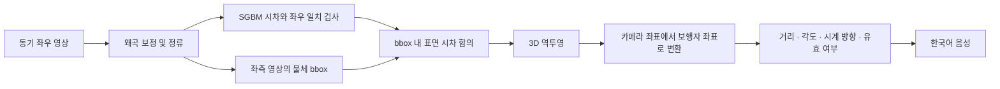

# 스테레오로 물체의 거리·각도·시계 방향을 구하는 알고리즘

구현: [`cv_project/depth/stereo.py`](../cv_project/depth/stereo.py), ROS 연결: [`cv_project/pipeline/stereo_node.py`](../cv_project/pipeline/stereo_node.py).

이 코드는 물체의 알려진 크기나 시뮬레이터 좌표를 사용하지 않습니다. 입력은 동기화한 좌우 영상, 스테레오 보정값, 사람에 대한 카메라 설치 위치·자세, 물체의 이름과 bbox입니다.



D는 선택한 탐지 backend가 제공합니다. `yolo26`은 정류된 좌측 영상에 실제 YOLO26 추론을 수행합니다. 재현용 `baseline`만 Webots 정답에서 **id, class, bbox, confidence만** 내보내며 정답 거리·위치는 버립니다. 두 모드는 동일한 공통 계약을 사용합니다.

## 1. 동기화와 보정

ROS 노드는 좌우 이미지와 bbox의 촬영 시각이 일치하는 경우만 결합합니다. 처리량이 부족하면 가장 최근의 완전한 좌우 쌍을 선택합니다. 각 영상의 K/D/R/P에서 `initUndistortRectifyMap`을 만들어 정류하며, 이미 정류된 Webots 영상은 그대로 사용합니다. bbox는 **정류된 좌측 영상의 픽셀 좌표**여야 합니다.

물리 카메라로 이전할 때는 실측 스테레오 캘리브레이션과 카메라→사람 외부 보정값이 필요합니다. 현재 시간 결합은 정확히 같은 타임스탬프를 요구하므로, 하드웨어 동기화나 별도의 제한된 오차를 허용하는 동기화 계층이 필요합니다. 이미지 해상도를 바꾸면 K/P의 픽셀 단위 파라미터도 함께 바꿔야 합니다.

## 2. 시차와 깊이

정류한 영상에서 같은 점의 좌우 수평 픽셀 위치를 `uL`, `uR`로 두면 시차는 `d = uL - uR`입니다. 좌우 주점이 다를 수 있으므로 `d_corrected = d - (cxL - cxR)`로 보정합니다.

```
B = PL[0,3]/fxL - PR[0,3]/fxR
Z = fx × B / d_corrected
X = (u - cxL) × Z / fx
Y = (v - cyL) × Z / fy
```

여기서 B는 m, 초점거리와 시차는 px입니다. Z는 카메라 전방 깊이(m), X는 오른쪽(m), Y는 아래쪽(m)입니다. OpenCV SGBM의 고정소수점 시차는 16으로 나누어 px 단위로 바꿉니다.

현재 f≈502.299px, B=0.12m이므로 예를 들어 보정 시차 20px는 카메라 전방 깊이 약 3.014m에 해당합니다. 사람 기준의 수평 거리는 설치 변환을 적용한 뒤 별도로 계산합니다.

## 3. 유효 픽셀과 물체 표면 선택

SGBM 계산 후 뒤집은 우측 영상에서도 대응을 구해 좌우 시차가 1.5px 이내로 일치하는 픽셀만 사용합니다. 설정한 깊이 범위 밖의 값은 버립니다.

bbox의 경계와 하단 일부는 배경·바닥이 섞이기 쉬워 제외합니다. 남은 시차 히스토그램에서 지지가 많은 군집을 찾고, 그 군집에 속한 픽셀의 중앙 시차와 중앙 위치를 사용합니다. 픽셀 24개 미만, 군집 지지 부족, 큰 깊이 불확실성 등은 측정 실패입니다. 투명·반사면, 무늬 없는 기둥, 가림, bbox 안의 넓은 배경에서는 실패하거나 잘못된 군집을 고를 수 있습니다. 현재는 instance segmentation을 사용하지 않습니다.

출력의 거리는 **bbox 안에서 추정한 보이는 표면의 대표점까지 거리**입니다. 물체 중심의 정답 거리나 물체 전체에서 가장 가까운 표면까지의 여유 거리는 아닙니다.

`depth_uncertainty_m`는 시차 MAD와 최소 0.5px를 바탕으로 `σZ ≈ Z² σd / (fx B)`로 추산합니다. 경험적 확률 보정이나 전체 시스템의 오차 보장은 아닙니다. 잘못된 대응 군집은 이 수치만으로 검출되지 않을 수 있습니다.

## 4. 보행자 기준 좌표와 방향

정류 좌표는 `R_left.T`로 원래 좌측 optical 좌표계로 되돌린 뒤, 설치 외부 보정값 `T_person_from_optical`을 적용합니다.

```
P_optical = R_left.T × P_rectified
P_person = T_person_from_optical × [P_optical, 1]
```

보행자 좌표계는 전방 +x, 좌측 +y, 위쪽 +z입니다. 촬영 시점의 ROS TF가 있으면 그 변환을 사용하며, 없으면 리그 설정의 보정값을 사용합니다. 여기서 TF는 카메라의 장착 위치·자세이며 대상 물체의 정답 위치가 아닙니다.

```
수평 거리 = hypot(x_person, y_person)
방위각(시계방향 +) = degrees(atan2(-y_person, x_person))
시계 방향 = floor(방위각 / 30 + 0.5) mod 12
0은 12시로 표시
```

| 방향 | 방위각 예 | 시계 방향 |
| --- | --- | --- |
| 정면 | 0° | 12시 |
| 왼쪽 앞 | −30° | 11시 |
| 오른쪽 앞 | +30° | 1시 |
| 왼쪽 | −60° | 10시 |
| 오른쪽 | +60° | 2시 |

현재 카메라 시야에서는 11시/12시/1시가 주로 나오며, 일부만 보이는 물체와 설치 위치 보정 때문에 다른 구간이 나올 수도 있습니다. 사람 뒤쪽으로 변환되는 측정은 거부합니다.

## 5. 입출력 예

탐지 입력 `/assistive/detections` (`std_msgs/String`의 JSON):

```json
{
  "stamp_ns": 1024000000,
  "source": "yolo26",
  "coordinate_space": "rectified_left",
  "detections": [{"id": 1, "class": "signboard", "bbox_xyxy": [220, 160, 330, 370], "confidence": 0.9}]
}
```

`stamp_ns`는 탐지에 사용한 **영상 촬영 시각**이며 추론 완료 시각이 아닙니다. 커스텀 YOLO 모델 연결 시 `source`를 실제 모델에 맞게 지정하고, 클래스는 `object_classes.json`과 맞춥니다. id는 추적 id를 쓰는 것이 좋습니다.

성공한 측정에는 `valid`, `disparity_px`, `optical_xyz_m`, `person_xyz_m`, `depth_m`, `distance_m`, `forward_m`, `bearing_deg`, `clock_hour`, 픽셀 지지 수와 불확실성이 포함됩니다. 실패한 측정에는 `valid=false`, `reason`을 넣고 **거리·3D 위치를 출력하지 않습니다**. 정답값으로 채우는 fallback은 없습니다.

## 6. 검사

```bash
/usr/bin/python3 -m unittest discover -s tests -v
```

합성 영상의 알려진 16px/8px 이동으로 3m/6m 깊이 복원을 검사하며, 서로 다른 주점·외부 보정·시계 방향·무늬 없는 영상·잘못된 baseline·화면 밖 물체를 검사합니다. 보행의 발 디딤과 다리 IK 검사도 포함합니다. 실제 거리·재질·가림별 전체 정밀도 평가는 추가 실험이 필요합니다.

참고: [OpenCV StereoSGBM](https://docs.opencv.org/4.13.0/d2/d85/classcv_1_1StereoSGBM.html), [Camera Calibration and 3D Reconstruction](https://docs.opencv.org/4.13.0/d9/d0c/group__calib3d.html).
